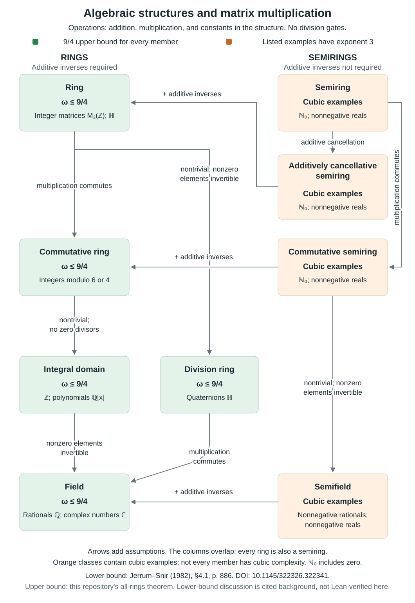

# Matrix multiplication: ω ≤ 9/4 over every ring

OpenAI proved ω ≤ 9/4 over the complex numbers in its
[matrix multiplication preprint](https://github.com/openai/math/blob/adc7f1241b42e322a6451854ab7e4b4c146bf78a/preprints/Matrix-Multiplication-Nine-Fourths-October-2-2026/paper.pdf).
Our [earlier all-fields extension](https://github.com/selanavot/matrix-multiplication-all-fields)
establishes the same bound over every field.
This repository extends the result to arbitrary associative unital
rings, including noncommutative rings.
The full theorem, including the trivial ring, has passed compilation, axiom audit,
fresh-kernel replay, and frozen-specification Comparator with all six bundled checkers.
See [verification details](verification/comparator/README.md) and
[current status](docs/STATUS.md).

**Both the extension's Lean proof development and the [paper](paper/paper.pdf)
are AI-generated with Codex under human direction.** The numerical exponent
and main proof architecture are OpenAI's. This is an extension of scope,
with no claim of a better numerical bound or independent human peer review.

## The theorem

[AllRings.lean](lean/OAI/LinearAlgebra/MatrixMultiplication/AllRings.lean):

```lean
theorem omega_le_nine_quarters_all_rings
    (R : Type u) [Ring R] :
    Arithmetic.omega R ≤ (9 : ℝ) / 4
```

The substantive statement change from the prior theorem is small:

```diff
- (F : Type u) [Field F] : Arithmetic.omega F ≤ (9 : ℝ) / 4
+ (R : Type u) [Ring R] : Arithmetic.omega R ≤ (9 : ℝ) / 4
```

The arithmetic model has exactly seven `Field` → `Ring` substitutions.
Its gate costs, evaluation, correctness quantifiers, positive exponent slack,
and infimum definition are unchanged. Nontriviality is retained for the lower
bound 2 and boundedness of the admissible-exponent set.

For the trivial ring, one free constant-zero register supplies every output.
Every real exponent is therefore admissible. The unchanged real-valued
definition gives `omega R = 0` by Mathlib's convention `sInf Set.univ = 0`;
the admissible set in this case has no genuine real infimum. The explicit
zero-cost program and the direct operation-count theorem avoid reliance on
that convention for the algorithmic claim.

The stronger intermediate theorem is `exactRankExponent_int_le_nine_quarters`:
the exponent of exact **integer coefficient tensor rank** is at most 9/4.
Those identities give programs over every ring, since integer constants are
central and each left-input factor stays before its right-input factor.

The direct operation-count theorem says that for every ε > 0 there is a
constant C > 0 and, for every matrix size n ≥ 1, a correct program costing
at most C n^(9/4 + ε) additions, subtractions and multiplications. This also
includes the zero ring. It is an existence theorem for arithmetic programs;
it does not establish an exact O(n^(9/4)) endpoint, an efficient uniform
circuit generator, or a bit-complexity bound.

## Where the bound applies



Green means the `9/4` upper bound holds throughout the class. Orange means the
class contains cubic examples, not that every member is cubic; rings are also
semirings. The comparison uses addition, multiplication and constants within
the chosen structure, with no division gates. Over rings, negative constants
simulate subtraction with constant-factor overhead.

For the nonnegative reals, matrix multiplication requires `n³` multiplication
gates in this model: Jerrum and Snir (1982),
[§4.1, p. 886](https://snir.cs.illinois.edu/listed/J7.pdf#page=13),
[DOI: 10.1145/322326.322341](https://doi.org/10.1145/322326.322341).
That counterexample rules out a universal semiring extension. This classical
lower bound is cited background, not formalized in this repository. See
[definitions, model details and full citation](docs/ALGEBRAIC-STRUCTURES.md)
or the [PNG diagram](docs/assets/algebraic-structures.png).

## What the extension adds

- A suitable integral tensor spectrum, avoiding the false assumption that
  every nonzero integer tensor restricts to the unit tensor.
- Division-free coefficient extraction and descent through one fixed finite
  free integer algebra after taking powers.
- Consecutive unnormalized Fourier periods, with their scalar multipliers
  cancelled by Bezout before character evaluation.
- Integral convolution schemes obtained by finite-field specialization,
  Vandermonde adjugates, integer norms, and a finite coprime patch.
- The inherited determinant, sector and profile argument over these inputs,
  followed by the bridge to arbitrary ring arithmetic.

See the [paper PDF](paper/paper.pdf), [LaTeX source](paper/paper.tex), and
[provenance](UPSTREAM.md). The paper has no author byline or date and is
associated with its repository commit.

## Citation and archival release

[CITATION.cff](CITATION.cff) describes the software citation, and
[.zenodo.json](.zenodo.json) supplies the proposed Zenodo archive metadata.
The archive includes the Lean development, paper and verification records.
The creator credit describes human direction of the project; the proof
development and manuscript remain explicitly disclosed as AI-generated.
The Zenodo release is prepared as an unpublished draft; no registered Zenodo
DOI or Palomar registration is claimed.

See [Zenodo release preparation](docs/ZENODO.md) and
[Palomar submission preparation](docs/PALOMAR.md). Palomar runs its own
verification against a fixed public commit; the local verification receipt
does not substitute for that registry workflow.
The [full Palomar mechanical preflight and registry verification passed](verification/palomar/README.md)
for the submitted snapshot. Permanent registration remains pending;
no registry acceptance is claimed.

## Build and verify

Lean **4.35.0-rc4** and Mathlib
`f0469b25d97aef3998d4bc06f6f01da670b3d18e` are pinned.

```sh
lake exe cache get
LEAN_NUM_THREADS=1 lake build
LEAN_NUM_THREADS=1 lake build OAI.LinearAlgebra.MatrixMultiplication.FinalAudit
python3 scripts/check-specification.py
bash scripts/check-kernel.sh
python3 scripts/check-comparator.py --trusted-local --negative-controls
```

The specification checker freezes the original model plus only the seven
approved typeclass substitutions. Comparator checks six statements, including
BddBelow, the lower bound, direct costs, and exact integer coefficients.
The strengthened theorem's [verification receipt](verification/comparator/RESULTS.md)
records the fresh runs. The unchanged harness's earlier deliberate controls rejected
changed multiplication cost and `sorry`; their [separate receipt](verification/comparator/RESULTS-NONTRIVIAL.md)
is preserved with its original scope.
The local Comparator command disables its build sandbox; it is not a claim
of sandboxed source-provenance verification. See [audit details](verification/comparator/README.md).

Development uses a serialized build queue on this machine:
`python3 scripts/lean-queue.py submit --owner NAME Module.Name`.
Only the coordinator starts `worker`; `stop` drains the current request.
Stop the worker before kernel/Comparator checks; the scripts share its lock.
The [working agreements](AGENTS.md) document ownership and resource limits.
